# Para

A commute app for the Philippines. Para puts every route on a map
(jeepneys, buses, UV Express, the LRT/MRT, ferries and tricycles), plans trips
with transfers across them, tells you the fare before you ride, shows live
vehicles coming your way, and wakes you up before your stop.

Free for commuters, no ads. Flutter app, Supabase (Postgres + PostGIS)
backend, Next.js admin panel. In development, heading to Google Play and the
App Store.

**The source code is private.** This repo is a showcase: what the app does,
how it's built, and some of the problems worth solving along the way. I'm
happy to walk through the code in an interview.

<p>
  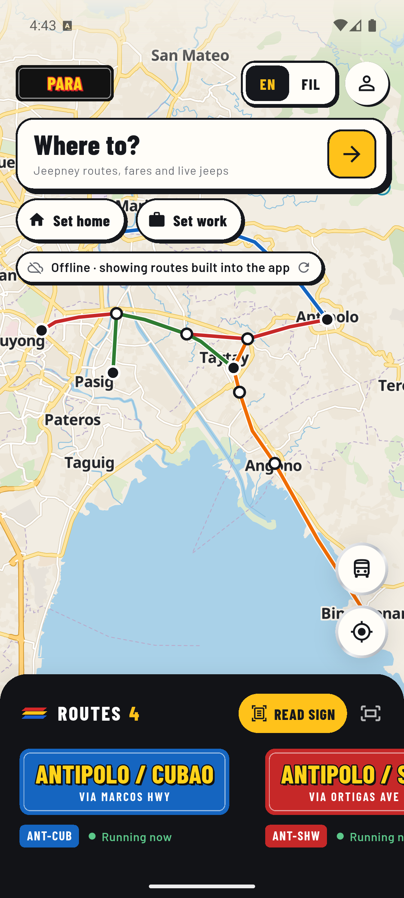
  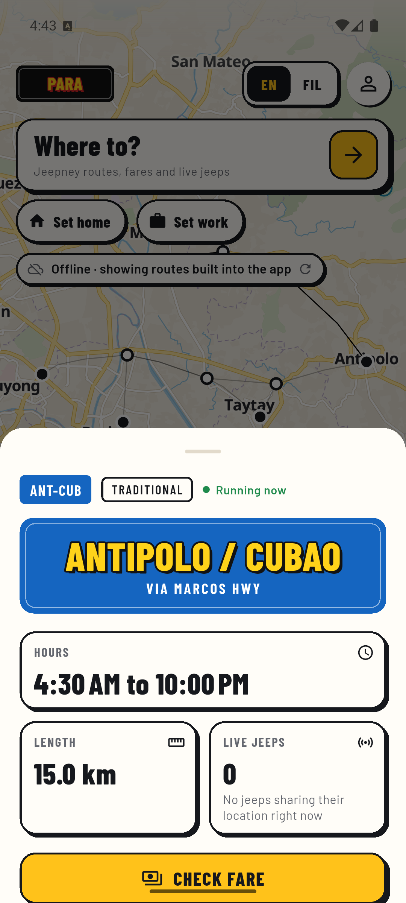
  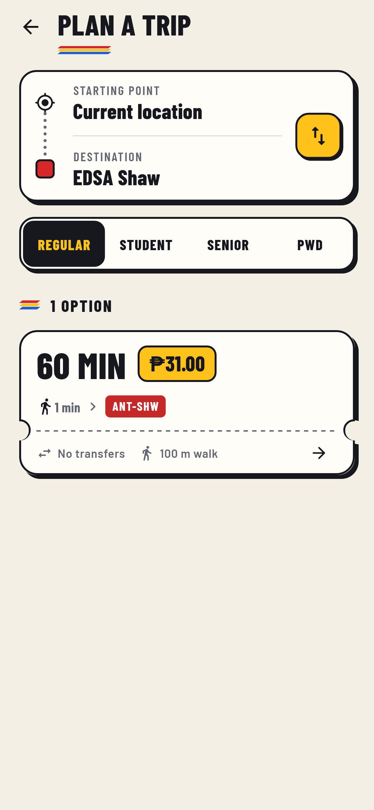
  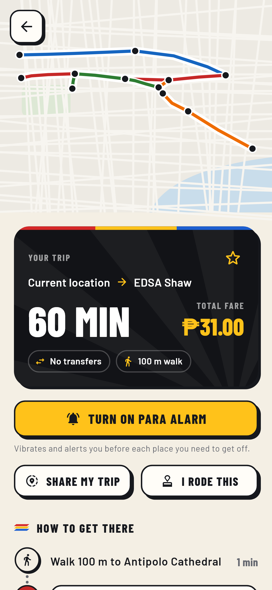
</p>
<p>
  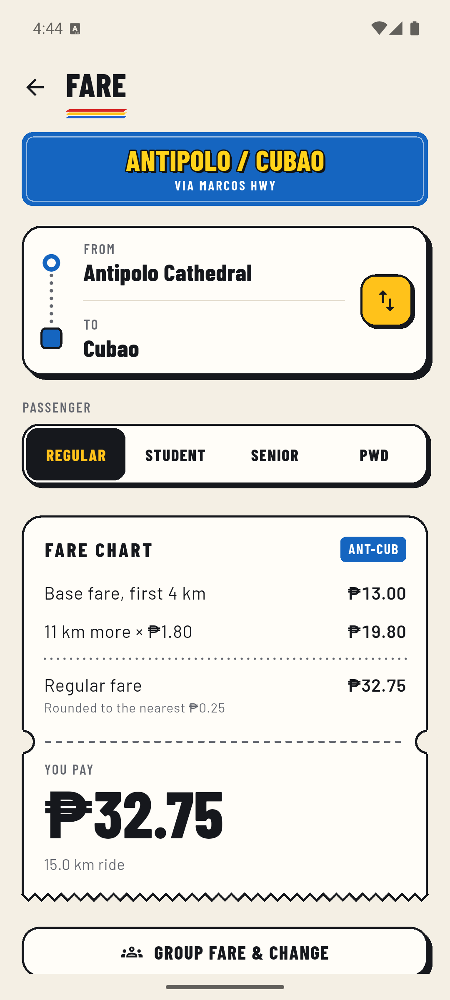
  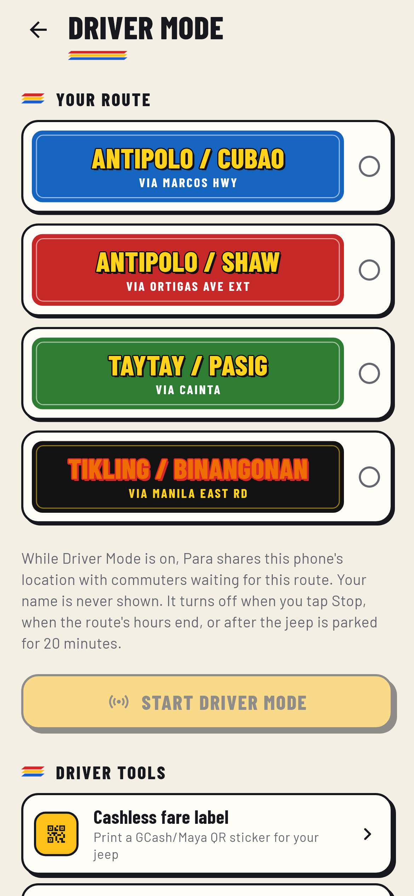
  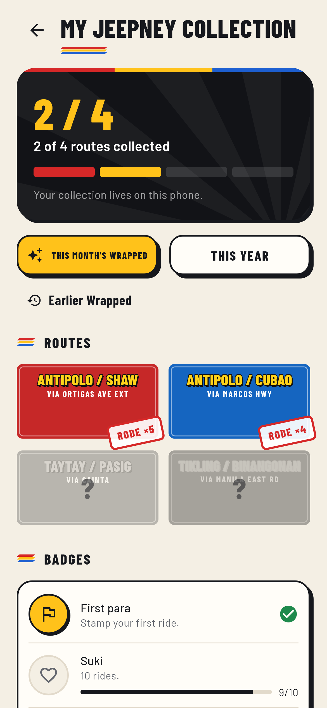
  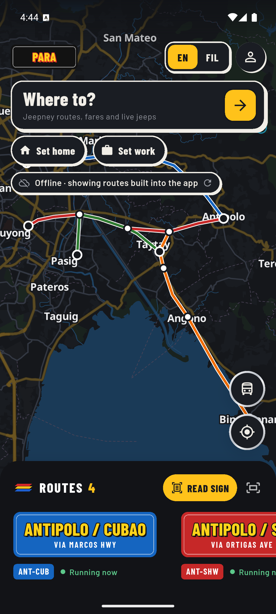
</p>

## Why

A commute in Metro Manila or Rizal is often two or three rides on different
kinds of transport. Jeepneys, UV Express and most buses have no timetable, no
fixed stops and no official map; you learn the routes by asking. Para turns
that into something you can search: where the routes go, which ones to take,
how much it costs, and where the next ride is right now.

## What it does

**For commuters**
- Every route on a map, drawn as its painted signboard. Tap a route for its
  stops, hours and fare; tap a terminal for the routes that pass it and a
  departure board.
- Trip planner with transfers across jeepneys, UV Express, buses, the LRT/MRT
  and the Pasig River Ferry. Plan to leave now, at a later time, or to arrive
  by a time. Runs entirely on the phone, so searches stay private and it
  works offline.
- Fares from the official fare matrices (regular, student, senior, PWD),
  station-to-station tables for trains, and an overcharge check.
- Live vehicles from drivers in Driver Mode and riders who share the ride
  they're on, with ETAs to each stop.
- Para Alarm: the phone vibrates before your stop, even in your pocket.
- Step-free trips for wheelchair users, using only accessible routes and
  stations with working lifts.
- Road reports (floods, closures, strikes) that the planner routes around.
- Share your trip as a live link, an SOS button, lost and found.
- English, Filipino and Bisaya, 200% text size and screen readers supported.

**For drivers and operators**
- Driver Mode: pick a route once and put the phone away. Location is shared
  in the background, throttled for battery and data, and stops by itself.
- Earnings log, a printable QR Ph fare label, dispatcher messages.
- Fleet dashboard for operators: vehicles on the road, trips per day, busy
  hours, maintenance, broadcasts.

**For staff and local governments**
- Admin panel: draw and edit routes on the map, fare matrices, moderation of
  reports, tips, photos and route suggestions.
- LGU dashboards with demand heatmaps (k-anonymized) and coverage gaps.
- An open GTFS feed of every route, including accessibility.

## How it's built

```
Flutter app (Android, iOS)            Supabase
  map (MapLibre, OpenFreeMap)    REST   Postgres + PostGIS
  trip planner, fares, ETAs  ─────────► views shaped for the app
  Driver Mode (background GPS)   WS     row level security on every table
  offline cache                 ─────►  Realtime broadcast for live jeeps
                                        pg_cron for nightly roll-ups
Next.js admin panel ───────────────────►
```

- **Trip planning on the phone.** A city's network is small, so the app
  downloads it and plans locally: no per-search cost, works offline, and the
  server never learns where anyone is going.
- **A planner for transport without timetables.** Routes are cut into points
  every ~150 m with ride and transfer edges. Dijkstra over (node, jeeps
  used) finds the best trip with one, two and three rides in one search,
  then trips are priced with the real fare rules and filtered for options
  that aren't worse on every count. It uses measured jeep speeds and waits
  from Driver Mode history where it has them.
- **Live tracking at low cost.** Positions go out only when the jeep moved
  40 m and 8 s passed (about one update every 10 s), and are broadcast per
  route instead of using row-level change feeds. Direction and progress
  along one-way routes are worked out the same way on the phone and on the
  server.
- **Security in the database.** Every table has row level security and a
  pgTAP test for who can read and write it. The admin panel never uses the
  service key; anything privileged is a database function that checks
  access itself.
- **Privacy by default.** No account needed. Analytics are opt-in, recorded
  as coarse grid cells with no user id, and only shown in groups of 10 or
  more. People can download their data or delete their account.
- **Money as integers.** Every amount is whole centavos. Payments (not
  connected yet) use idempotency keys and a double-entry ledger that must
  balance.

## Numbers

| | |
|---|---|
| App (Dart) | ~26,000 lines, ~10,000 lines of tests |
| Database | 43 migrations, 38 pgTAP test files |
| Admin panel (TypeScript) | ~8,000 lines |
| Automated tests | ~590 app, ~390 database, ~85 admin |
| Milestones | 70, each one shipped with tests |

## Stack

Flutter, Dart, Riverpod, MapLibre GL, Supabase (Postgres, PostGIS, Auth,
Realtime, pg_cron), pgTAP, Next.js, TypeScript, Tailwind, Vitest, GitHub
Actions.

<p>
  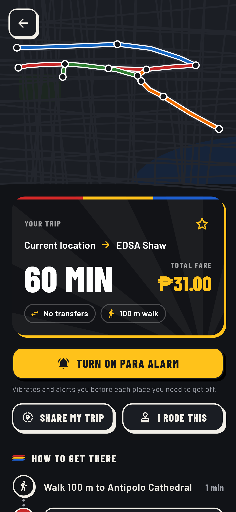
  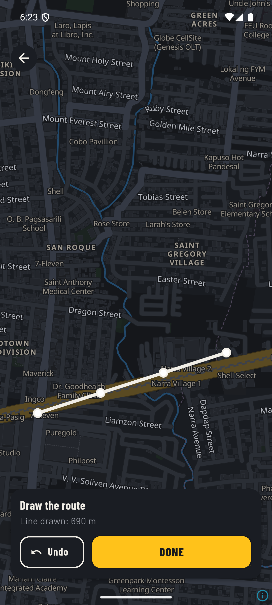
  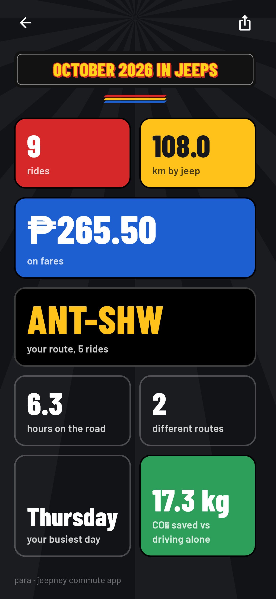
  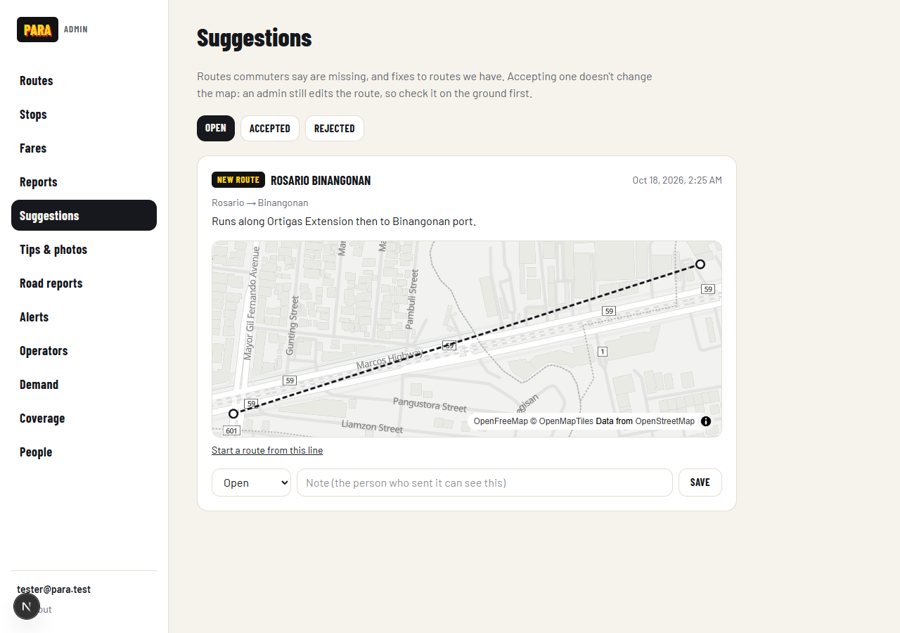
</p>
